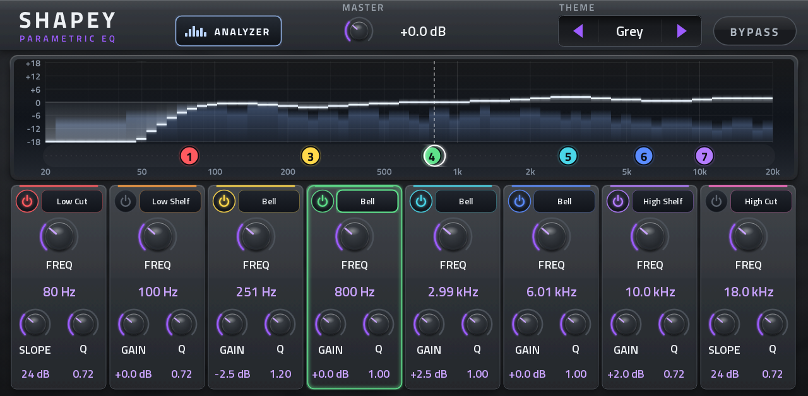
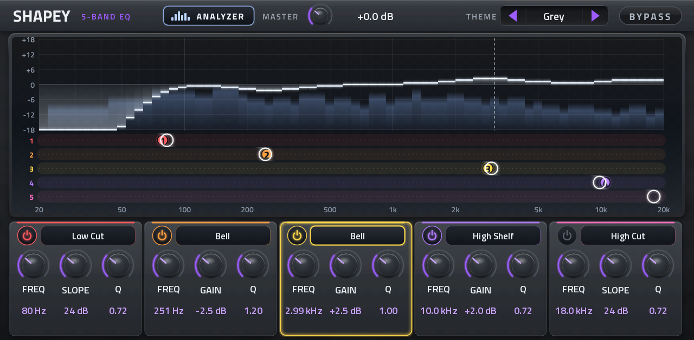

# Shapey EQ and Shapey 5-Band EQ

Two touch-first parametric EQs for Akai MPC OS standalone devices, as native VST2 audio effects built with
[mpc-vst-plugins](https://github.com/sd88me/mpc-vst-plugins). They run on the same engine and come as **two separate
plugins with their own releases**. Install either one or both; they show up in the plugin list under their own names.

| Shapey EQ (8 bands) | Shapey 5-Band EQ |
|---|---|
|  |  |

## What they do
- **Shape the curve by touch.** Tap or drag on the graph: the selected band jumps to that frequency and gain. The selected band is
  the last one you touched (its column, its knobs, its TYPE or its dot).
- **Numbered dots** in each band's colour sit under the curve at their frequencies. Drag one left and right to move its band.
  - Shapey EQ: one shared lane. It moves the selected band.
  - Shapey 5-Band EQ: every band has its own lane, so any dot can be dragged straight away. A slimmer header gives it a taller curve.
- **Any band, any type:** Bell, Low Shelf, High Shelf, Low Cut, High Cut, Notch or Band Pass.
  - The second knob follows the type: GAIN for bells and shelves, SLOPE (6/12/24/48 dB per octave) for cuts, none for notch and band pass.
  - Each band keeps its gain and its slope separately, so switching a type and back loses nothing.
  - A type change fades the band out and back in, so there's no click.
- **Live analyzer** (switchable) behind the curve, showing the sound after the EQ.
- Zero latency, smooth (click-free) knob moves, master gain, bypass, presets in MPC's own preset menu, four colour themes and
  Q-Link pages.

Default bands:
- **Shapey EQ:** Low Cut, Low Shelf, Bell 1-4, High Shelf, High Cut.
- **Shapey 5-Band EQ:** Low Cut, Low Shelf, Bell, High Shelf, High Cut.

## Install
Download the zip for the plugin you want from [Releases](../../releases):
- `Shapey-EQ-<version>-mpc-armv7.zip`
- `Shapey-5-Band-EQ-<version>-mpc-armv7.zip`

Each zip has an `INSTALL.md` with the requirements and steps. The scripted install runs `install.sh` as root on the device,
so it is for modded units. Gen1 devices (MPC Live/One/X/Key 61/Force); tested on an MPC Live II.

## Build
Needs a checkout of [mpc-vst-plugins](https://github.com/sd88me/mpc-vst-plugins) next to this one, and Docker.
```bash
MV=../mpc-vst-plugins
$MV/tools/test_port.sh vst/vst.json  && $MV/tools/build_port.sh vst/vst.json     # Shapey EQ
$MV/tools/test_port.sh vst5/vst.json && $MV/tools/build_port.sh vst5/vst.json    # Shapey 5-Band EQ
```
- Engine tests and the on-device checklist: [TESTING.md](TESTING.md).
- Release zips are built by GitHub Actions: **Actions → Release → Run workflow**, then pick the plugin and the version. That makes a draft release.
- The skin artwork is pre-drawn:
  - `tools/make_skin_art.py` redraws it (`SHAPEY_BANDS=5` for the 5-band version).
  - `tools/make_params.py` writes both parameter lists and preset banks.

## License
MIT. See [LICENSE](LICENSE). The DSP (RBJ biquads, the analyzer) is original code. The fonts used to draw the skin come from
mpc-vst-plugins (Titillium Web, SIL Open Font License).
